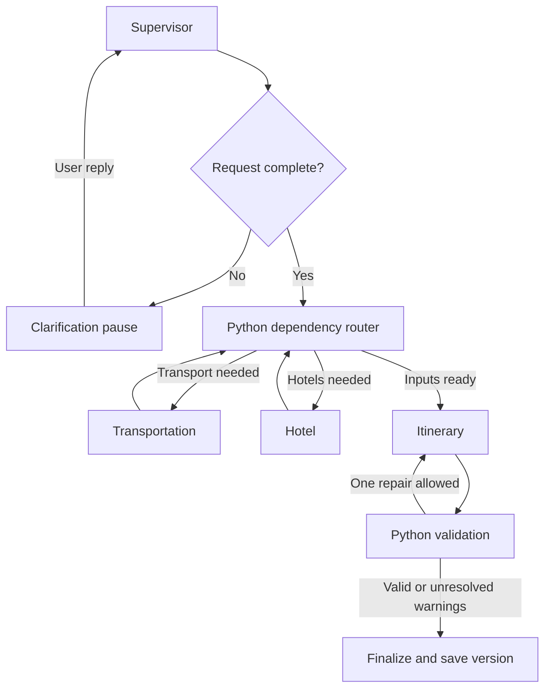

# Agreed architecture — implementation blueprint

Status: Checkpoint 04 adds optional LangChain/Groq Supervisor intake before the
structured validation/clarification/routing from checkpoint 03. The diagram
below remains the product blueprint: the other three LLM specialists,
selection, plan validation/repair and snapshot finalization are not connected yet.

## Responsibilities

| Agent | LLM decisions | Deterministic Python responsibilities |
|---|---|---|
| Supervisor | Interpret request, clarify omissions, propose delegation, explain results | Validate request, enforce allowed routes, locks and dependency rules |
| Transportation | Compare viable train/flight options using user preferences | Resolve stations/airports, run ordered searches, shortlist, fetch fares, normalize timings |
| Hotel | Explain and rank suitable stays | Map price/class/rating filters, validate occupancy and prices, enforce hard constraints |
| Itinerary | Select and organize supplied place candidates into daily activities | Retrieve Maps/weather data, validate IDs, opening hours, buffers and arithmetic |

The supervisor's route is a structured proposal. Python checks it against a
small allowed-action enum and the outstanding work list. It cannot invent an
endpoint, unlock a selection, or authorize a purchase. Specialist agents receive
only relevant validated state; all four can use the same Groq model.

LangChain supplies ChatGroq, messages, tool definitions and structured model
responses. LangGraph supplies stateful execution, nodes, conditional routing
and checkpoint-based resumption. These do not automatically implement business
rules for budgets, selection locks or product version history.

## Execution and routing

Specialists run sequentially initially to simplify state updates, quota handling
and debugging. The router removes completed work from a pending set, and never
routes directly from the dependency router back to the Supervisor. A graph step
bound and one itinerary repair attempt prevent endless cycles. New chat turns
start with the Supervisor, which can answer existing-plan questions without
new searches. Itinerary execution may organize data already held in trip state.

Rail tools have a fixed internal order: resolve station candidates; Trains
Between; filter and shortlist in Python; Fare Calculator for the shortlist;
Timetable only when more detail is needed. The LLM does not discover this order
by trial and error. Ambiguous station/city names require user clarification or
clearly presented candidates. No seats/PNR/live-running endpoints are planned.

## State, storage and API boundary

Plan state: trip ID, messages/relevant conversation summary, validated request,
clarification fields, pending components, normalized offers and source metadata,
selected IDs, locks, places, weather, itinerary, issues, repair count, token usage
and short activity trace. API credentials never enter graph state.

Use one FastAPI process for the local demo. Streamlit sends ordinary JSON calls
to it; the backend owns keys, graph execution and provider clients. Return an
activity trace when work completes; no live streaming is required initially.
Local SQLite graph checkpoints support clarification resumption; a small
application repository stores numbered plan snapshots. These are separate
concepts: graph checkpoints track execution; product snapshots track user plans.
Frontend session state retains trip ID. Keep database files under ignored data/.
Serialize changes to a trip and reject stale version updates to prevent lost edits.
This is a local portfolio demo, not an authenticated public multi-tenant service.

## Replanning, locks and version rules

| Change | Recompute | Preserve when compatible |
|---|---|---|
| Hotel price/class/rating | Hotels, cost subtotal; itinerary if selected location affects it | Transport |
| Mode, transport date or timing | Affected transport, itinerary and cost subtotal | Hotel only if stay dates/occupancy remain valid |
| Interests or activity pace | Places as needed, itinerary | Hotels and transport |
| Origin | Transport, itinerary and subtotal | Destination hotels with unchanged stay |
| Destination, trip dates or travelers | All affected searches, itinerary and subtotal | Only explicitly validated compatible selections |
| Explanation-only question | No searches | Current plan |

Selection locks preserve a user's chosen option while compatible. A lock is not
a reservation or price guarantee. An incompatible update pauses for user choice;
never silently unlock or present stale data as current. Failed replanning keeps
the last completed version and exposes the failure separately.

Snapshots are numbered, viewable plan copies. No branching, restoration or
event-sourcing system. Markdown download exports the currently viewed version
with source timestamps, cost exclusions and warnings.

## Conflict handling and cost truthfulness

Python checks unknown IDs, date bounds, hotel coverage, arrival/departure buffers,
overlapping activities, known hours, locked selections and numeric subtotals.
Initially use conservative configurable buffers and label travel durations between
places as estimates; Maps search is not a route-duration service. Missing hours
remain unverified. Daily weather does not prove a particular hour will be dry.

If a train arrives after a scheduled activity, give the Itinerary Agent a precise
validation message and allow one repair without changing locked transport/hotel.
If still invalid, return the unresolved conflict visibly. Hard constraints are
never silently relaxed. Rank only complete comparable fares/room offers; unknown
components make budget feasibility unknown. Attraction prices are optional,
unverified provider information and excluded from the core subtotal.

## Modules to implement

| Path | Purpose |
|---|---|
| backend/main.py | Thin FastAPI endpoints and health check |
| backend/config.py | Local configuration and secret handling |
| backend/schemas.py | Pydantic requests, normalized offers and responses |
| backend/graph/state.py, builder.py | Shared state and readable routing |
| backend/agents/ | Four focused agent modules |
| backend/providers/ | SerpApi, RailRadar and Open-Meteo HTTP adapters |
| backend/services/ | Filters, validation, dependency rules, snapshots, Markdown export |
| frontend/app.py | Streamlit chat, results, locks, versions and download |
| tests/, evaluation/ | Deterministic tests and labeled evaluation cases |

Implemented in checkpoint 02: backend/config.py, backend/schemas.py,
backend/services/costs.py, backend/services/replanning.py and tests/test_domain.py.
Checkpoint 03 adds backend/graph/state.py and builder.py, synthetic demo workers,
scripts/demo_workflow.py and tests/test_workflow.py. Checkpoint 04 adds backend/llm.py,
backend/agents/supervisor.py, tests/test_supervisor.py and scripts/check_supervisor.py.
Intake accepts structured patches or natural language with a configured Supervisor.
Clarification resumes accept a patch or natural-language reply. Its finalize node marks
workflow completion, not a validated travel plan or saved product version.
The remaining module map is planned. Lock compatibility with changed offers
and graph enforcement remain pending; the primitive only detects replacement,
removal and unlock attempts. No agent files are presented as working stubs.

## Design references

- https://docs.langchain.com/oss/python/langgraph/graph-api
- https://docs.langchain.com/oss/python/langgraph/interrupts
- https://docs.langchain.com/oss/python/integrations/chat/groq
- https://console.groq.com/docs/structured-outputs

Separate tool selection and final structured-answer calls where required by the
selected Groq model. The Supervisor wrapper path is tested with intercepted HTTP;
the earlier successful Groq tests used raw HTTP, not this framework integration.
