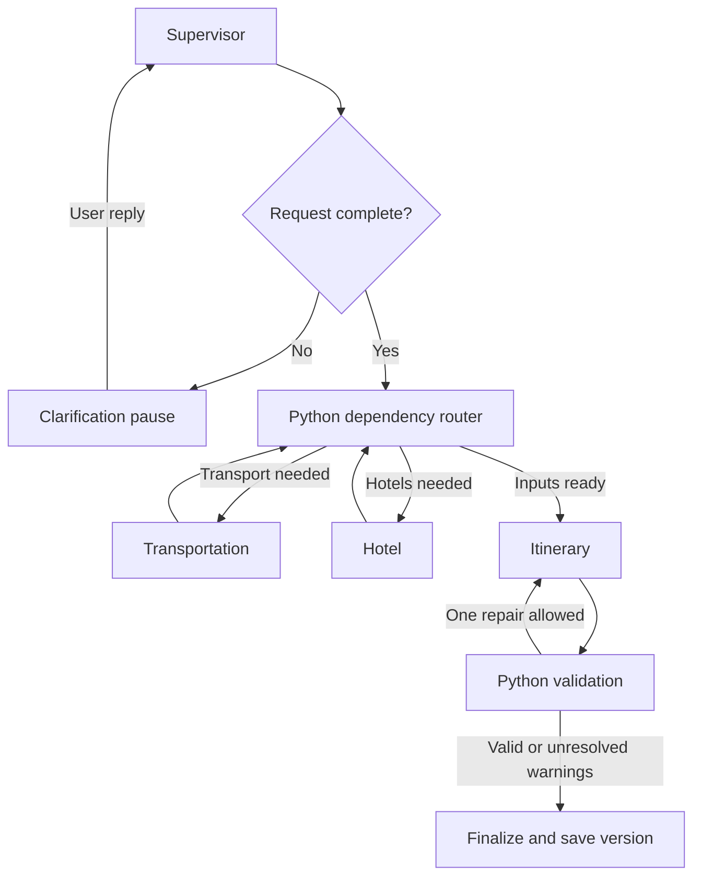

# Agreed architecture — implementation blueprint

Status: Checkpoint 06 retains four LLM roles using explicitly synthetic graph
retrieval and adds separate real hotel/Maps adapters with a bounded live checker.
The diagram remains the product blueprint: provider-to-graph integration, other
providers, retained locks, version storage and UI are still pending. Current finalize returns a draft
recommendation, not a reservation or completed product plan version.

## Responsibilities

| Agent | LLM decisions | Deterministic Python responsibilities |
|---|---|---|
| Supervisor | Interpret request, clarify omissions, propose delegation, explain results | Validate request, enforce allowed routes, locks and dependency rules |
| Transportation | Compare viable train/flight options using user preferences | Resolve stations/airports, run ordered searches, shortlist, fetch fares, normalize timings |
| Hotel | Explain and rank suitable stays | Map price/class/rating filters, validate occupancy and prices, enforce hard constraints |
| Itinerary | Select and organize supplied place candidates into daily activities | Retrieve Maps/weather data, validate IDs, opening hours, buffers and arithmetic |

The supervisor's route is a structured proposal. Python checks it against a
small allowed-action enum and the outstanding work list. It cannot invent an
endpoint, unlock a selection, or authorize a purchase. Specialist agents receive
only relevant validated state; all four can use the same Groq model.

LangChain supplies ChatGroq, messages, tool definitions and structured model
responses. LangGraph supplies stateful execution, nodes, conditional routing
and checkpoint-based resumption. These do not automatically implement business
rules for budgets, selection locks or product version history.

## Execution and routing

Specialists run sequentially initially to simplify state updates, quota handling
and debugging. The router removes completed work from a pending set, and never
routes directly from the dependency router back to the Supervisor. A graph step
bound and one itinerary repair attempt prevent endless cycles. New chat turns
start with the Supervisor, which can answer existing-plan questions without
new searches. Itinerary execution may organize data already held in trip state.

Rail tools have a fixed internal order: resolve station candidates; Trains
Between; filter and shortlist in Python; Fare Calculator for the shortlist;
Timetable only when more detail is needed. The LLM does not discover this order
by trial and error. Ambiguous station/city names require user clarification or
clearly presented candidates. No seats/PNR/live-running endpoints are planned.

## State, storage and API boundary

Plan state: trip ID, messages/relevant conversation summary, validated request,
clarification fields, pending components, normalized offers and source metadata,
selected IDs, locks, places, weather, itinerary, issues, repair count, token usage
and short activity trace. API credentials never enter graph state.

Use one FastAPI process for the local demo. Streamlit sends ordinary JSON calls
to it; the backend owns keys, graph execution and provider clients. Return an
activity trace when work completes; no live streaming is required initially.
Local SQLite graph checkpoints support clarification resumption; a small
application repository stores numbered plan snapshots. These are separate
concepts: graph checkpoints track execution; product snapshots track user plans.
Frontend session state retains trip ID. Keep database files under ignored data/.
Serialize changes to a trip and reject stale version updates to prevent lost edits.
This is a local portfolio demo, not an authenticated public multi-tenant service.

## Replanning, locks and version rules

| Change | Recompute | Preserve when compatible |
|---|---|---|
| Hotel price/class/rating | Hotels, cost subtotal; itinerary if selected location affects it | Transport |
| Mode, transport date or timing | Affected transport, itinerary and cost subtotal | Hotel only if stay dates/occupancy remain valid |
| Interests or activity pace | Places as needed, itinerary | Hotels and transport |
| Origin | Transport, itinerary and subtotal | Destination hotels with unchanged stay |
| Destination, trip dates or travelers | All affected searches, itinerary and subtotal | Only explicitly validated compatible selections |
| Explanation-only question | No searches | Current plan |

Selection locks preserve a user's chosen option while compatible. A lock is not
a reservation or price guarantee. An incompatible update pauses for user choice;
never silently unlock or present stale data as current. Failed replanning keeps
the last completed version and exposes the failure separately.

Snapshots are numbered, viewable plan copies. No branching, restoration or
event-sourcing system. Markdown download exports the currently viewed version
with source timestamps, cost exclusions and warnings.

## Conflict handling and cost truthfulness

Python checks unknown IDs, date bounds, hotel coverage, arrival/departure buffers,
overlapping activities, known hours, locked selections and numeric subtotals.
Initially use conservative configurable buffers and label travel durations between
places as estimates; Maps search is not a route-duration service. Missing hours
remain unverified. Daily weather does not prove a particular hour will be dry.

If a train arrives after a scheduled activity, give the Itinerary Agent a precise
validation message and allow one repair without changing locked transport/hotel.
If still invalid, return the unresolved conflict visibly. Hard constraints are
never silently relaxed. Rank only complete comparable fares/room offers; unknown
components make budget feasibility unknown. Attraction prices are optional,
unverified provider information and excluded from the core subtotal.

## Modules to implement

| Path | Purpose |
|---|---|
| backend/main.py | Thin FastAPI endpoints and health check |
| backend/config.py | Local configuration and secret handling |
| backend/schemas.py | Pydantic requests, normalized offers and responses |
| backend/graph/state.py, builder.py | Shared state and readable routing |
| backend/agents/ | Four focused agent modules |
| backend/providers/ | SerpApi, RailRadar and Open-Meteo HTTP adapters |
| backend/services/ | Filters, validation, dependency rules, snapshots, Markdown export |
| frontend/app.py | Streamlit chat, results, locks, versions and download |
| tests/, evaluation/ | Deterministic tests and labeled evaluation cases |

Implemented in checkpoint 02: backend/config.py, backend/schemas.py,
backend/services/costs.py, backend/services/replanning.py and tests/test_domain.py.
Checkpoint 03 adds backend/graph/state.py and builder.py, synthetic demo workers,
scripts/demo_workflow.py and tests/test_workflow.py. Checkpoint 04 adds backend/llm.py,
backend/agents/supervisor.py, tests/test_supervisor.py and scripts/check_supervisor.py.
Checkpoint 05 adds the other three agent classes, ranking/offer filters,
schedule validation, specialist fixtures, tests/test_specialists.py and check_agents.py.
Intake accepts structured patches or natural language with a configured Supervisor.
Clarification resumes accept a patch or natural-language reply. Its finalize node marks workflow completion or draft readiness; neither is a
saved product version or booking.
Checkpoint 06 implements providers/http.py and providers/serpapi.py for hotel and
Maps retrieval, plus scripts/check_providers.py and tests/test_providers.py.
Flight/rail/weather providers and server/UI/version/export modules remain planned. Lock compatibility with changed offers
and graph enforcement remain pending; the primitive only detects replacement,
removal and unlock attempts. No agent files are presented as working stubs.

## Design references

- https://docs.langchain.com/oss/python/langgraph/graph-api
- https://docs.langchain.com/oss/python/langgraph/interrupts
- https://docs.langchain.com/oss/python/integrations/chat/groq
- https://console.groq.com/docs/structured-outputs

Separate tool selection and final structured-answer calls where required by the
selected Groq model. Supervisor's wrapper path is now live-verified. All four
roles also pass intercepted-HTTP tests. The user verified all four roles live on
Windows using synthetic travel evidence: five calls including repair, 6,845 tokens.

## Checkpoint 05 implementation boundary

TransportationAgent and HotelAgent call injected search functions, then apply
Python hard filters and request a native structured ranking. Python verifies
that every eligible ID appears exactly once. ItineraryAgent uses the first ranked
candidate per transport leg and first ranked hotel as proposed recommendations;
these are not user-locked selections. It retrieves normalized place candidates
and schedules supplied IDs. Known hours, estimated transfer gaps, arrival/return
buffers and pace are checked in services/scheduling.py. One correction is allowed.

Finalization looks up recommended IDs in the actual normalized offers before
summing their complete quotes. No selected/recommended ID means no verified
component cost. Over-budget or invalid schedules require review. Unknown taxes,
traveler scope, prices or currency produce unknown totals. Existing zero-call
routing demos still use legacy workers and keep unknown subtotals.

Graph node worker interfaces remain ordinary callables. Four real LLM roles are
injected by scripts/check_agents.py; zero-call demos inject demo_workers instead.
The fixture module never serves as a live-provider fallback. Model errors stop
new model work; earlier completed per-role token usage is retained and failed
unreported usage remains unknown. Current live check performs four LLM calls,
with at most one extra itinerary correction. No tool-calling loop is implemented
in the new specialists yet; Python owns retrieval order.

## Checkpoint 06 retrieval boundary

`SerpApiHttp` owns a fixed HTTPS endpoint, 30-second timeout, zero retries, no
redirect following and a redacted attempted-request ledger. The adapter maps
validated preferences to provider parameters; parsers return typed offers/places,
warnings and response field names. They preserve source timestamps separately
from local retrieval time. Provider defaults may use cached results.

Hotel class and guest rating are separate filters. Unsupported 1-star API filtering
is omitted rather than changed to 2 stars; Python applies the original constraint.
Price bounds are widened to whole units for the API then checked exactly in Python.
Explicit after-tax fields are recognized, but room occupancy/type are unverified;
such prices cannot establish a complete payable subtotal. Search echo mismatches
are rejected. Missing totals stay null. Place hours support search/detail shapes,
closed days and multiple intervals; ambiguous hours remain unknown. Exact provider
IDs are deduplicated; nearby aliases/geographic relevance still need review.

The live checker bypasses the graph and LLM to isolate provider behavior: at most
one hotel search plus one Maps search, stopping on an error. It saves readable
HTML and JSON with matching input parameters. It never substitutes fixture data.
Return/arrival-based hotel dates, geographic validation, optional weather and
integration with agent retrieval callbacks remain next-stage work.
