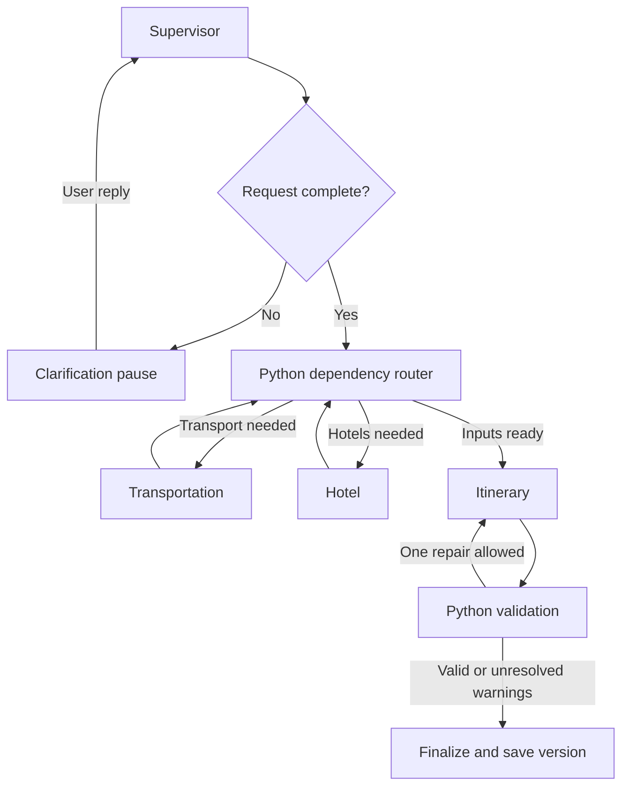

# Agreed architecture — implementation blueprint

Status: Checkpoint 10 connects the four LLM roles to provider-backed retrieval
through validated LangChain tools, with explicit selected location bindings.
Train pricing now has an explicitly approved deterministic mock mode. Schedule
and price provenance are separate. General location selection/UI remain pending.
The recovery revision adds failed-Itinerary resumption without new agents,
database layers, retry loops or changes to the product scope.
The diagram remains the product blueprint: general location selection, weather,
providers, retained locks, version storage and UI are still pending. Current finalize returns a draft
recommendation, not a reservation or completed product plan version.

## Responsibilities

| Agent | LLM decisions | Deterministic Python responsibilities |
|---|---|---|
| Supervisor | Interpret request, clarify omissions, propose delegation, explain results | Validate request, enforce allowed routes, locks and dependency rules |
| Transportation | Compare viable train/flight options using user preferences | Resolve stations/airports, run ordered searches, shortlist, fetch fares, normalize timings |
| Hotel | Explain and rank suitable stays | Map price/class/rating filters, validate occupancy and prices, enforce hard constraints |
| Itinerary | Select and organize supplied place candidates into daily activities | Retrieve Maps/weather data, validate IDs, opening hours, buffers and arithmetic |

The supervisor's route is a structured proposal. Python checks it against a
small allowed-action enum and the outstanding work list. It cannot invent an
endpoint, unlock a selection, or authorize a purchase. Specialist agents receive
only relevant validated state; all four can use the same Groq model.

LangChain supplies ChatGroq, messages, tool definitions and structured model
responses. LangGraph supplies stateful execution, nodes, conditional routing
and checkpoint-based resumption. These do not automatically implement business
rules for budgets, selection locks or product version history.

## Execution and routing

Specialists run sequentially initially to simplify state updates, quota handling
and debugging. The router removes completed work from a pending set, and never
routes directly from the dependency router back to the Supervisor. A graph step
bound and one itinerary repair attempt prevent endless cycles. New chat turns
start with the Supervisor, which can answer existing-plan questions without
new searches. Itinerary execution may organize data already held in trip state.

Rail tools have a fixed internal order: resolve station candidates; Trains
Between; filter and shortlist in Python; Fare Calculator for the shortlist;
Timetable only when more detail is needed. The LLM does not discover this order
by trial and error. Ambiguous station/city names require user clarification or
clearly presented candidates. No seats/PNR/live-running endpoints are planned.

## State, storage and API boundary

Plan state: trip ID, messages/relevant conversation summary, validated request,
clarification fields, pending components, normalized offers and source metadata,
selected IDs, locks, places, weather, itinerary, issues, repair count, token usage
and short activity trace. API credentials never enter graph state.

Use one FastAPI process for the local demo. Streamlit sends ordinary JSON calls
to it; the backend owns keys, graph execution and provider clients. Return an
activity trace when work completes; no live streaming is required initially.
Local SQLite graph checkpoints support clarification resumption; a small
application repository stores numbered plan snapshots. These are separate
concepts: graph checkpoints track execution; product snapshots track user plans.
Frontend session state retains trip ID. Keep database files under ignored data/.
Serialize changes to a trip and reject stale version updates to prevent lost edits.
This is a local portfolio demo, not an authenticated public multi-tenant service.

## Replanning, locks and version rules

| Change | Recompute | Preserve when compatible |
|---|---|---|
| Hotel price/class/rating | Hotels, cost subtotal; itinerary if selected location affects it | Transport |
| Mode, transport date or timing | Affected transport, itinerary and cost subtotal | Hotel only if stay dates/occupancy remain valid |
| Interests or activity pace | Places as needed, itinerary | Hotels and transport |
| Origin | Transport, itinerary and subtotal | Destination hotels with unchanged stay |
| Destination, trip dates or travelers | All affected searches, itinerary and subtotal | Only explicitly validated compatible selections |
| Explanation-only question | No searches | Current plan |

Selection locks preserve a user's chosen option while compatible. A lock is not
a reservation or price guarantee. An incompatible update pauses for user choice;
never silently unlock or present stale data as current. Failed replanning keeps
the last completed version and exposes the failure separately.

Snapshots are numbered, viewable plan copies. No branching, restoration or
event-sourcing system. Markdown download exports the currently viewed version
with source timestamps, cost exclusions and warnings.

## Conflict handling and cost truthfulness

Python checks unknown IDs, date bounds, hotel coverage, arrival/departure buffers,
overlapping activities, known hours, locked selections and numeric subtotals.
Initially use conservative configurable buffers and label travel durations between
places as estimates; Maps search is not a route-duration service. Missing hours
remain unverified. Daily weather does not prove a particular hour will be dry.

If a train arrives after a scheduled activity, give the Itinerary Agent a precise
validation message and allow one repair without changing locked transport/hotel.
If still invalid, return the unresolved conflict visibly. Hard constraints are
never silently relaxed. Rank only complete comparable fares/room offers; unknown
components make budget feasibility unknown. Attraction prices are optional,
unverified provider information and excluded from the core subtotal.

## Modules to implement

| Path | Purpose |
|---|---|
| backend/main.py | Thin FastAPI endpoints and health check |
| backend/config.py | Local configuration and secret handling |
| backend/schemas.py | Pydantic requests, normalized offers and responses |
| backend/graph/state.py, builder.py | Shared state and readable routing |
| backend/agents/ | Four focused agent modules |
| backend/providers/ | SerpApi, RailRadar and Open-Meteo HTTP adapters |
| backend/services/ | Filters, validation, dependency rules, snapshots, Markdown export |
| frontend/app.py | Streamlit chat, results, locks, versions and download |
| tests/, evaluation/ | Deterministic tests and labeled evaluation cases |

Implemented in checkpoint 02: backend/config.py, backend/schemas.py,
backend/services/costs.py, backend/services/replanning.py and tests/test_domain.py.
Checkpoint 03 adds backend/graph/state.py and builder.py, synthetic demo workers,
scripts/demo_workflow.py and tests/test_workflow.py. Checkpoint 04 adds backend/llm.py,
backend/agents/supervisor.py, tests/test_supervisor.py and scripts/check_supervisor.py.
Checkpoint 05 adds the other three agent classes, ranking/offer filters,
schedule validation, specialist fixtures, tests/test_specialists.py and check_agents.py.
Intake accepts structured patches or natural language with a configured Supervisor.
Clarification resumes accept a patch or natural-language reply. Its finalize node marks workflow completion or draft readiness; neither is a
saved product version or booking.
Checkpoint 06 implements providers/http.py and providers/serpapi.py for hotel and
Maps retrieval, plus scripts/check_providers.py and tests/test_providers.py.
Checkpoint 07 adds providers/flights.py, services/place_aliases.py and
tests/test_flights.py. Checkpoint 08 adds providers/rail_http.py and railradar.py,
scripts/check_rail.py and tests/test_rail.py. Weather and server/UI/version/export modules
remain planned. Lock compatibility with changed offers
and graph enforcement remain pending; the primitive only detects replacement,
removal and unlock attempts. No agent files are presented as working stubs.

## Design references

- https://docs.langchain.com/oss/python/langgraph/graph-api
- https://docs.langchain.com/oss/python/langgraph/interrupts
- https://docs.langchain.com/oss/python/integrations/chat/groq
- https://console.groq.com/docs/structured-outputs

Separate tool selection and final structured-answer calls where required by the
selected Groq model. Supervisor's wrapper path is now live-verified. All four
roles also pass intercepted-HTTP tests. The user verified all four roles live on
Windows using synthetic travel evidence: five calls including repair, 6,845 tokens.

## Checkpoint 05 implementation boundary

TransportationAgent and HotelAgent call injected search functions, then apply
Python hard filters and request a native structured ranking. Python verifies
that every eligible ID appears exactly once. ItineraryAgent uses the first ranked
candidate per transport leg and first ranked hotel as proposed recommendations;
these are not user-locked selections. It retrieves normalized place candidates
and schedules supplied IDs. Known hours, estimated transfer gaps, arrival/return
buffers and pace are checked in services/scheduling.py. One correction is allowed.

Finalization looks up recommended IDs in the actual normalized offers before
summing their complete quotes. No selected/recommended ID means no verified
component cost. Over-budget or invalid schedules require review. Unknown taxes,
traveler scope, prices or currency produce unknown totals. Existing zero-call
routing demos still use legacy workers and keep unknown subtotals.

Graph node worker interfaces remain ordinary callables. Four real LLM roles are
injected by scripts/check_agents.py; zero-call demos inject demo_workers instead.
The fixture module never serves as a live-provider fallback. Model errors stop
new model work; earlier completed per-role token usage is retained and failed
unreported usage remains unknown. Current live check performs four LLM calls,
with at most one extra itinerary correction. No tool-calling loop is implemented
in the new specialists yet; Python owns retrieval order.

## Checkpoint 06 retrieval boundary

`SerpApiHttp` owns a fixed HTTPS endpoint, 30-second timeout, zero retries, no
redirect following and a redacted attempted-request ledger. The adapter maps
validated preferences to provider parameters; parsers return typed offers/places,
warnings and response field names. They preserve source timestamps separately
from local retrieval time. Provider defaults may use cached results.

Hotel class and guest rating are separate filters. Unsupported 1-star API filtering
is omitted rather than changed to 2 stars; Python applies the original constraint.
Price bounds are widened to whole units for the API then checked exactly in Python.
Explicit after-tax fields are recognized, but room occupancy/type are unverified;
such prices cannot establish a complete payable subtotal. Search echo mismatches
are rejected. Missing totals stay null. Place hours support search/detail shapes,
closed days and multiple intervals; ambiguous hours remain unknown. Exact provider
IDs are deduplicated; nearby aliases/geographic relevance still need review.

The live checker bypasses the graph and LLM to isolate provider behavior: at most
one hotel search plus one Maps search, stopping on an error. It saves readable
HTML and JSON with matching input parameters. It never substitutes fixture data.
Return/arrival-based hotel dates, geographic validation, optional weather and
integration with agent retrieval callbacks remain next-stage work.

## Checkpoint 07 flight and source-quality boundary

FlightAdapter receives explicit AirportLocation bindings (code, city, timezone)
and searches one leg at a time. It validates the city route before spending a
request, maps explicit class/sort/price filters, and uses type=2. Return calls
reverse airports and use the return date. There is no round-trip token workflow.
FlightSegment preserves carrier/flight number and aware departure/arrival times;
the parser checks route, date, chronological order and airport continuity. Every
airport's timezone must be supplied; unknown or ambiguous local times are skipped.
General city-to-airport discovery and selection remain pending.

Flight quotes preserve one-way scope but do not infer multi-passenger coverage or
tax completeness. Python's existing complete-price cap check remains conservative.
Search links are source pages, not reservations. The new --category flights probe
makes at most two requests and does not call the LLM or change existing --category
all behavior. Real provider retrieval is still separate from the four-agent graph.

The hotel/Maps live report exposed a stale date-bearing hotel URL and nearby
stepwell aliases with differing hours. Hotel links with explicit date/night/guest
conflicts are discarded in favor of a general source URL, when available. Opaque
link parameters are not verified, so no URL is described as guaranteed checkout.
Place alias detection requires coordinates within 40 m plus matching normalized
names or stepwell/kund synonyms. It flags possible duplicates without merging
them. Schedules cannot include both flagged candidates; their hours stay unverified.
This narrow heuristic is not a general geographic entity-resolution system.

## Checkpoint 08 rail boundary

No extra agent or graph node is introduced. RailRadarAdapter exposes station
lookup and a readable search_leg: dated services -> Python duration shortlist ->
Timetable for required coach-class/ordered-stop checks -> one fare. StationBinding
contains a selected code and display city. The probe explicitly checks NDLS and
JP lookup matches first; selecting among general city candidates remains pending.
Timetable may precede fares when needed to avoid requesting an unsupported class.

The probe's two station lookups plus one leg need at most six requests: schedules,
two train details maximum and one fare maximum. HTTP uses a fixed host, Bearer
header, timeout, zero redirects/retries, endpoint allowlist, redacted audit and
numeric quota headers. Returned zero remaining quota stops before the next call.
This six-request budget belongs to the probe, not Groq account limits. Application
request budgets remain explicit and must respect independent provider quotas.

Scheduled TransportOffer records carry train name/number and station codes. Dates
are at the boarding station; arrival uses destination-day minus boarding-day.
The parser does not add the train-origin day offset or filter runDays against the
wrong date. Unknown/mismatched times/durations/route records are skipped. Standard
five-digit train identifiers are supported initially. Return direction is tested
offline but not yet by this single-leg live probe.

Operated coach classes do not verify seat availability. Fare totals are retained
as unverified quotes, with numeric breakdown and request parameters. No passenger
count multiplication or tax-completeness claim is made. Errors leave completed
scheduled results in the report, never fixture replacements. General RailRadar
source URLs are not checkout links. Graph wiring was pending at checkpoint 08;
checkpoint 10 below adds the provider-backed composition.

Flight normalization now returns safe skipped-record codes and known airport IDs;
exception text and raw discarded records are not saved. This improves future
diagnostics; it cannot reconstruct the three records omitted in the reviewed live
flight report. No repeat of successful flights is required for the rail checkpoint.

## Checkpoint 09 approved price assumptions

The paid rail fare call returned PLAN_UPGRADE_REQUIRED. The user approved assumed
train fares for the interview demo, including unseen train/route/class combinations.
This changes the price-source policy, not schedule truthfulness or agent count.

services/demo_fares.py validates evidence, hashes train|from|to|class with SHA-256,
maps to an arbitrary class range, and multiplies the invented per-adult amount by
adults. No per-train table, LLM guessing, process-random hash, network call or new
agent. Date and passenger count do not enter the per-adult key. Rule version tracks
range/key changes; neither distance nor real railway pricing is modelled.

PriceQuote.pricing_mode=demo, per_adult_amount and demo_rule_version identify the
assumption. Source continues describing the real schedule. Synthetic schedule/
place fixture separation stays enforced; only explicitly labelled price assumptions
can accompany confirmed real evidence. Mock mode does not create unsupported
routes/classes, verify seats or imply a current fare quote.

TRAIN_FARE_MODE defaults to mock. Mock retrieval checks up to two shortlisted
services and never calls /fare. Explicit live mode keeps the paid endpoint and
does not fall back to mock on failure. Class evidence survives a failed fare call.
check_rail.py --replay-report can apply mock prices to saved JSON/ZIP evidence with
zero network calls and unchanged historical source timestamps. It is an explicit
replay, not an implicit live-failure fallback or fresh availability check.

CostSummary separates assumed_components and illustrative_subtotal/status from
verified totals. Real budget_status remains unknown with any assumed price.
Illustrative full-trip comparison needs all other required prices to have complete
comparable scope; other unknown occupancy/taxes/currency still prevent a full
decision. Agent prompts and graph warnings must preserve these distinctions.
Future UI, versions and export must display ASSUMED DEMO FARE prominently.

## Checkpoint 10 connected execution

runtime.py composes four agents with the existing graph. TravelProviderSession
owns lazy provider clients and explicit JourneyBindings, three StructuredTool
wrappers, safe audits and provider failure gates. Python calls tool.invoke with
TripPreferences; the model does not autonomously choose endpoints. There is no
tools-plus-native-schema request. Full normalized source evidence stays in state;
ranking/scheduling messages omit long source URLs/notes to reduce prompt size.

The new script verifies an explicit Delhi/Jaipur route. General location selection
is not implemented and no autocomplete is silently accepted. Runtime intake asks
for mode/currency/class as required before spending provider calls. The per-run
session is not a cache: rebuild it for a new execution while reusing trip checkpoints.

Transport calls independent outbound/return legs, with two timetable-checked train
candidates or four normalized flight candidates per leg. Comparison can use the
healthy provider after the other fails. Auth/quota/network/server errors block more
calls to that provider during the run. No synthetic schedules/places are substituted.
Provider warnings survive tool/agent boundaries and enter the graph warnings.

Hotels use ranked transport arrival and return departure dates in the destination
zone. A changed stay invalidates incompatible held hotels. Original user dates
are preserved. Missing transport leaves requested-date quotes with an uncertainty
warning; impossible overnight coverage cannot produce a valid itinerary.

check_connected.py explicitly enables a bounded full run: <=5 Groq, <=4 SerpApi,
<=6 RailRadar in mock fare mode (<=8 only if live fares explicitly requested).
Default train run expects only 2 SerpApi queries. Reports persist after graph-node
updates and retain safe request inputs, usage and evidence. No booking/seat/PNR
or weather call occurs. General locations, UI and product plan versions are pending.

### Recovery revision

Ranking requests use short local H01/T01 IDs; Python validates that every alias
appears once and maps back to original IDs. Complete records remain in state.
Ranking messages omit repeated hotel dates/adults and the whole-trip budget.
Finalization still computes budget feasibility. Incomplete/assumed-price offers
receive guarded scope explanations; an LLM reason cannot establish affordability.

ItineraryAgent retains fetched places before calling the model. A ModelCallError
now preserves them in the graph. scripts/connected_recovery.py validates a saved
failed-Itinerary report, including routes, dates, hard constraints, unique IDs,
live-source labels and hotel coverage. It creates a state seed containing the
completed recommendations and pending=["itinerary"]. check_connected.py calls
graph.update_state(..., as_node="hotels"), then graph.stream(None, ...). These are
LangGraph's existing checkpoint/resumption operations. No Supervisor, transport
or hotel worker runs during recovery. Missing places cause one Maps query; held
places cause none. Schedule generation still permits only one correction.

Resumption preserves original timestamps and price provenance. It does not imply
fresh availability, new room quotes or product version restoration. New usage
is reported separately from historical counters; unknown failed-call usage stays
unknown. A 429 is visible as MODEL_RATE_LIMITED, with evidence retained and no
automatic HTTP retry or fixed pacing. Product architecture remains four agents.

### Hotel ranking fix

Short aliases reduce payload size but do not guarantee a complete ID list. If a
parsed hotel ranking fails the ID check, the Hotel Agent discards it and uses a
deterministic order over the same hard-filtered offers: comparable quoted nightly
price, higher guest rating, then stable ID. Unknown and incomparable prices sort
after comparable quotes. A report warning records the local sort. This requires
no retry, leaves provider/model request failures on their existing paths and
does not relax filters or price completeness checks.
